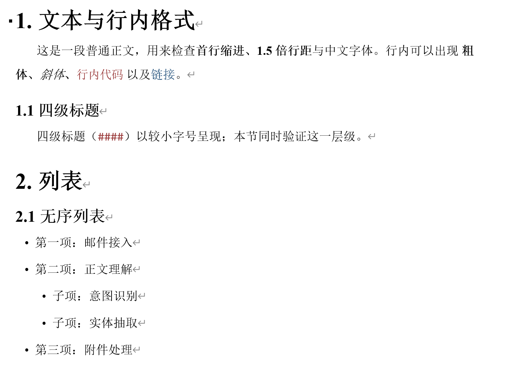
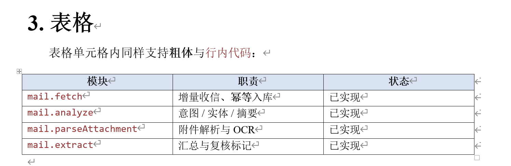
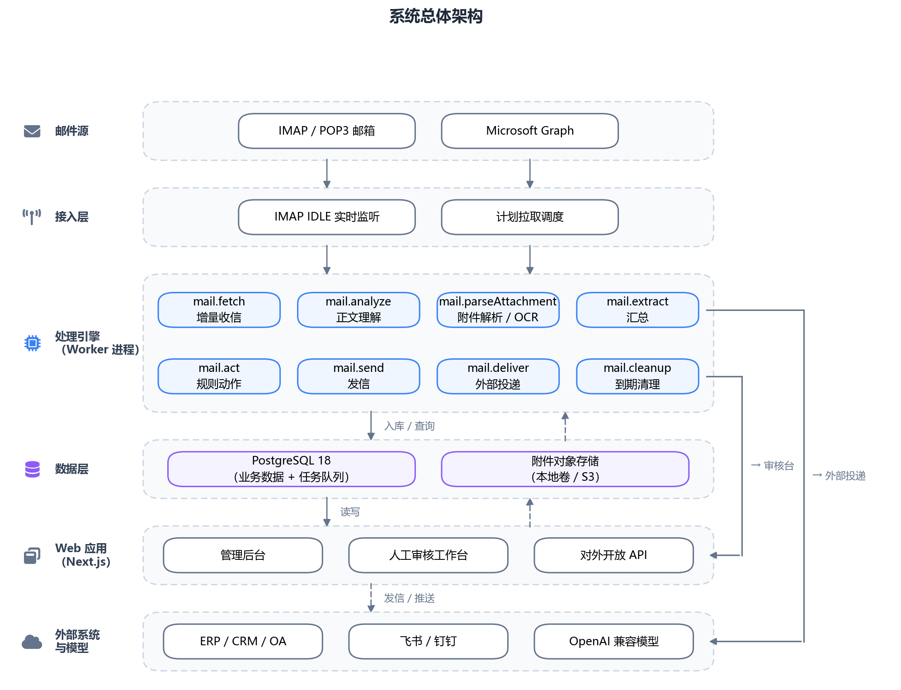

<h1 align="center">md-to-docx</h1>

<p align="center"><b>把 Markdown 转成可直接交付的 Word 文档——其中的图由 AI agent 亲手绘制。</b></p>

<p align="center">
  
  
  
  
  
</p>

一个遵循 [Agent Skills](https://agentskills.io/) 开放标准的 skill。装进 **Claude Code**、**Codex CLI**
（或任何支持该标准的工具）之后，直接说「把这份 md 转成 Word」，agent 就会读懂文档里的 mermaid 图、
为每张图手写绘图脚本、跑几何自检，最后产出带正确配图的 `.docx`。

零外部渲染服务：不需要 pandoc、mermaid-cli、Chromium，也不需要任何在线服务——只要 `python-docx` + `matplotlib`。

**能力一览**

- **Markdown → Word**：标题分级（`#` 作封面标题、`##` 起每章分页）、段落、`**粗体**` / `*斜体*` /
  `` `行内代码` ``、`[链接]()`、有序 / 无序列表、管道表格（Table Grid + 表头底纹）、`> 引用`、
  `---` 分隔线、``、` ```lang ` 代码块。
- **图**：文档里每个 ` ```mermaid ` 块，按**出现顺序**替换为 `<diagrams 目录>/diagram_N.png`——
  由绘图脚本手绘，不是自动渲染。已内置三类范例：分层架构图、竖向主链 + 分叉、时序图。
- **版式**：A4 / 四边 2.54cm；正文宋体 + Times New Roman 12pt、1.5 倍行距、首行缩进 0.74cm；
  图统一「清爽商务」配色（白卡片 + 中性灰描边 + 少量强调色）。

## 目录

- [效果预览](#效果预览)
- [它解决什么问题](#它解决什么问题)
- [安装到 agent 工具](#安装到-agent-工具)
- [命令行使用](#命令行使用)
- [自检](#自检)
- [图样式](#图样式)
- [目录结构](#目录结构)
- [限制](#限制)
- [许可与致谢](#许可与致谢)

## 效果预览

下面是 `examples/demo.docx` 的实际渲染（由 `examples/demo.md` 转换而来）。

**正文排版**——宋体 + Times New Roman 12pt、1.5 倍行距、首行缩进 0.74cm：



**表格**——Table Grid 边框 + 表头底纹（`#D9E2F3`）：



**图**——文档里的 mermaid 块会被替换成**手绘的图**（不是自动渲染）。下例是 `diagrams/architecture.py` 产出的系统总体架构图：



## 它解决什么问题

常见的 md → docx 路线各有痛点：

| 方案 | 问题 |
| --- | --- |
| pandoc | 需额外安装；mermaid 仍是代码文本 |
| mermaid-cli | 要拉 Chromium；国内网络常拉不动 |
| 在线渲染（mermaid.ink / kroki） | 受限网络直接不可用 |
| **mermaid 自动布局（自研或库）** | **结构经常是错的**——拿不到语义，不知道哪些节点该并排、哪条是主链路 |

本 skill 的取舍：**刻意不做自动布局**。布局是语义决策——哪些节点该并排、哪条是主链路，
这些信息在图**意**里，不在语法里。所以由 agent 读懂图意后**显式指定坐标**，工具只提供绘图原语与自检。
agent 的强项是写代码；把布局这件事交回给它，换来结构正确。

## 安装到 agent 工具

### 1) 装 Python 依赖

```bash
pip install -r requirements.txt      # python-docx, matplotlib
```

已验证：Python 3.12、python-docx 1.2.0、matplotlib；Windows 上自动选 Microsoft YaHei 渲染中文。

### 2) 放进工具的 skills 目录

| 工具 | 全局（所有项目可用） | 项目级（只在该项目生效） |
| --- | --- | --- |
| Claude Code | `~/.claude/skills/md-to-docx/` | `<项目>/.claude/skills/md-to-docx/` |
| Codex CLI | `~/.codex/skills/md-to-docx/` | `<项目>/.codex/skills/md-to-docx/` |

> 本仓库目录名已与 `SKILL.md` 的 `name` 一致（都是 `md-to-docx`），满足
> [Agent Skills 标准](https://agentskills.io/specification)「目录名必须等于 name」的要求——
> 所以**整目录拷贝即可直接使用，无需重命名**。若你日后改了 `name`，记得同步改目录名。
> 校验可用官方参考工具 `skills-ref validate ./md-to-docx`；各工具的 skills 路径以自家文档为准。

在**本 skill 目录下**执行（macOS / Linux / Git Bash）：

```bash
# Claude Code
mkdir -p ~/.claude/skills && cp -r . ~/.claude/skills/md-to-docx

# Codex CLI
mkdir -p ~/.codex/skills && cp -r . ~/.codex/skills/md-to-docx
```

Windows PowerShell：

```powershell
# Claude Code
New-Item -ItemType Directory -Force "$HOME\.claude\skills" | Out-Null
Copy-Item -Recurse -Force . "$HOME\.claude\skills\md-to-docx"

# Codex CLI
New-Item -ItemType Directory -Force "$HOME\.codex\skills" | Out-Null
Copy-Item -Recurse -Force . "$HOME\.codex\skills\md-to-docx"
```

### 3) 触发

重启工具让它索引到新 skill，然后两种用法都行：

- **显式调用**：在 Claude Code 里输入 `/md-to-docx`；
- **自然语言**：直接说「把 `docs/方案.md` 转成 Word」「这份 md 里的架构图帮我一并画好导出 docx」。

agent 会自己读 `SKILL.md`、按「四步法」画图、跑自检、再转 docx。

## 命令行使用

不经过 agent、直接敲命令也能跑：

```bash
# 1) 画图（照 diagrams/architecture.py 抄，或用 _template.py 起步）
python diagrams/architecture.py     # -> diagrams/assets/diagram_1.png，并打印自检报告
python diagrams/pipeline.py         # -> diagrams/assets/diagram_2.png
python diagrams/sequence.py         # -> diagrams/assets/diagram_3.png（时序图）

# 2) 转换
python scripts/md_to_docx.py examples/demo.md --diagrams diagrams/assets
# -> examples/demo.docx
```

无图场景直接 `python scripts/md_to_docx.py 你的文档.md` 即可。

## 自检

看不到图时，`finalize()` 就是唯一的迭代信号——它会检测并打印五项：

| 检查 | 说明 |
| --- | --- |
| 文字溢出 | 盒内文字超出盒宽/高 |
| 容器标题溢出 | `band()` 的标题超出所属容器（竖排长标题最容易中招） |
| 节点重叠 | 两个 `box` 矩形相交（按**实际渲染包围盒**判定，不是声明尺寸） |
| 超出画布 | 坐标越出 0~1 |
| 消息过密 | 时序图相邻消息 y 间距 < 0.042 |

```
[自检 PASS] diagrams/assets/diagram_1.png
```

只要有一项 FAIL，就调坐标 / 尺寸后重跑，直到全 PASS 再进入转换。

## 图样式

所有示例共用一套默认样式——「清爽商务」：白卡片 + 中性灰描边（slate 色阶）+ 少量强调色（蓝 / 紫），
边线与箭头按 WCAG 非文本对比度 ≥3.0 选取。色值集中在 `scripts/diagram_kit.py` 顶部常量，
**改一处全局生效**（`diagrams/architecture.py` 只额外声明逐层强调色）。
历史候选对照见 `diagrams/assets/preview/`（生成脚本 `diagrams/_style_preview.py`）。

## 目录结构

```
md-to-docx/
├── SKILL.md              操作手册（四步法、绘图原语、成功判据）——agent 读的就是它
├── README.md             本文件（给人看）
├── requirements.txt      python-docx, matplotlib
├── assets/fonts/         图标字体（Font Awesome Free，含许可说明）
├── scripts/
│   ├── md_to_docx.py     md → docx（CLI）
│   └── diagram_kit.py    绘图原语 + 自检
├── diagrams/
│   ├── _template.py      新图骨架（复制它开始画）
│   ├── _style_preview.py 样式候选对照（历史存档）
│   ├── architecture.py   范例 A：纵向分层带
│   ├── pipeline.py       范例 B：竖向主链 + 分叉
│   ├── sequence.py       范例 C：时序图
│   └── assets/           产出的 PNG（diagram_1.png …）
└── examples/             demo.md / demo.docx
    └── preview/          demo.docx 的渲染预览（README 的效果图）
```

## 限制

- 图靠手写坐标，**无自动布局兜底**——刻意的取舍。
- 已支持 **流程图**（范例 A/B）与 **时序图**（范例 C）；`gantt` / `classDiagram` 等需自行用绘图原语表达。
- 表格仅标准管道表；不支持目录（TOC）、脚注、参考文献。
- 图与文本的一致性靠约定（第 N 个 mermaid 块 ↔ `diagram_N.png`）+ 转换后核验，没有结构校验。

## 许可与致谢

- 图标字体 **Font Awesome Free**（图标 CC BY 4.0 / 字体 SIL OFL 1.1，要求署名），
  详见 `assets/fonts/README.md`。不想要图标可清空 `diagrams/architecture.py` 的 `BAND_ICONS`，
  绘图工具在字体缺失或名称为空时会静默跳过，不影响出图。

详见 SKILL.md。
