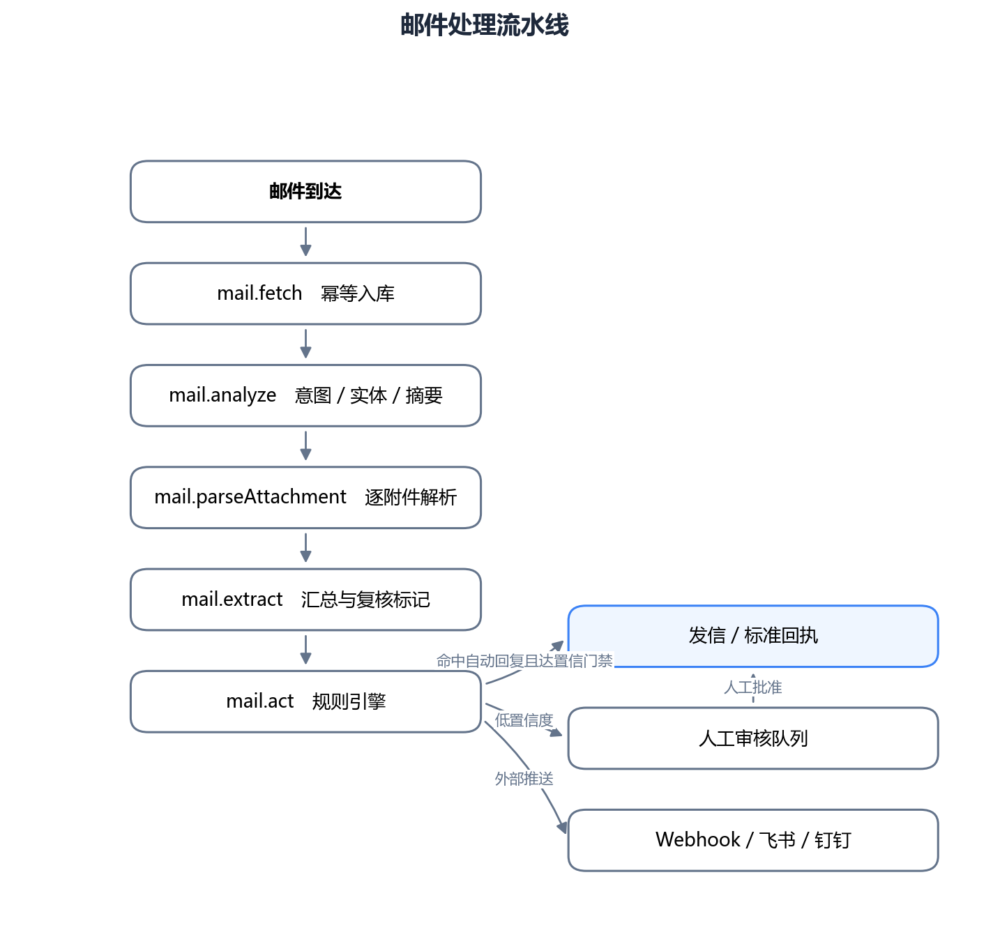
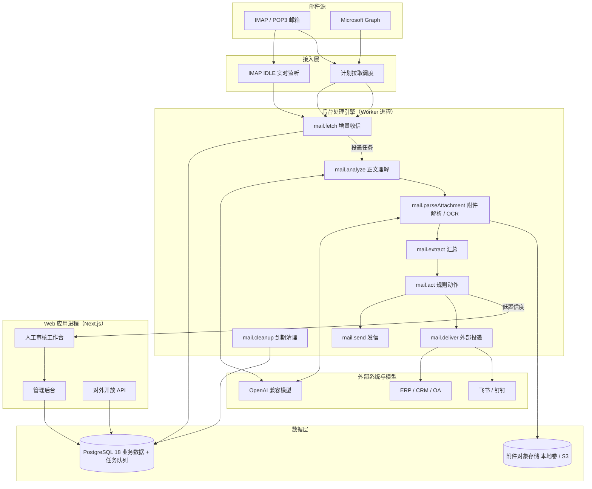
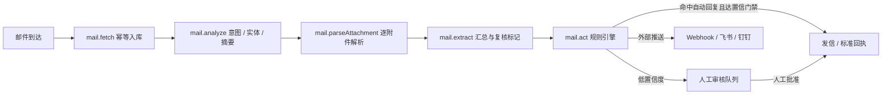
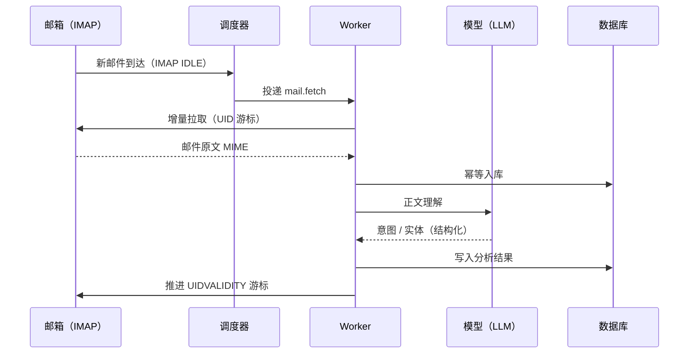

# 示例文档：md-to-docx 能力演示

> 本文件用于验证转换器的各类 Markdown 元素，并演示「图由 agent 手绘」的完整链路。
> 运行 `python scripts/md_to_docx.py examples/demo.md --diagrams diagrams/assets`
> 生成 `examples/demo.docx`。
>
> 注意第 7 节的 mermaid 文本与 `diagrams/architecture.py`、`diagrams/pipeline.py`、
> `diagrams/sequence.py` 画的图**一一对应**——这是 skill 的硬约定：md 里第 N 个
> mermaid 块必须与 `diagram_N.png` 内容一致。

---

## 1. 文本与行内格式

这是一段普通正文，用来检查**首行缩进**、**1.5 倍行距**与中文字体。
行内可以出现 **粗体**、*斜体*、`行内代码` 以及[链接](https://example.com)。

#### 1.1 四级标题

四级标题（`####`）以较小字号呈现；本节同时验证这一层级。

## 2. 列表

### 2.1 无序列表

- 第一项：邮件接入
- 第二项：正文理解
  - 子项：意图识别
  - 子项：实体抽取
- 第三项：附件处理

### 2.2 有序列表

1. 收信
2. 分析
3. 规则动作
4. 人工审核

## 3. 表格

表格单元格内同样支持**粗体**与`行内代码`：

| 模块 | 职责 | 状态 |
| --- | --- | --- |
| `mail.fetch` | 增量收信、**幂等**入库 | 已实现 |
| `mail.analyze` | 意图 / 实体 / 摘要 | 已实现 |
| `mail.parseAttachment` | 附件解析与 OCR | 已实现 |
| `mail.extract` | 汇总与复核标记 | 已实现 |

## 4. 引用块

> 预期内的失败用返回值表达，只有真正的意外才抛异常。

## 5. 代码块

围栏代码块按等宽字体（Consolas 9pt）逐行呈现，语言标记不参与排版：

```python
def ingest(mail):
    """幂等入库：uid 已存在则跳过。"""
    if db.exists(uid=mail.uid):
        return "skip"
    return db.insert(mail)
```

```bash
python scripts/md_to_docx.py examples/demo.md --diagrams diagrams/assets
```

## 6. 独立图片

独立图片用 `` 插入，路径相对本文件解析；下例指向 `../diagrams/assets/diagram_2.png`：



## 7. Mermaid 流程图

### 7.1 系统总体架构（对应 diagram_1.png）



### 7.2 邮件处理流水线（对应 diagram_2.png）



### 7.3 邮件收信与分析时序（对应 diagram_3.png）



## 8. 收尾

以上元素都能在生成的 Word 中正确呈现；mermaid 图会被替换为
`diagrams/assets/` 下手绘产出的图片，而不是代码文本。
